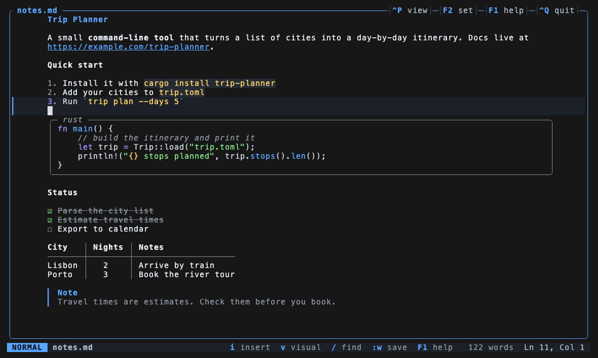
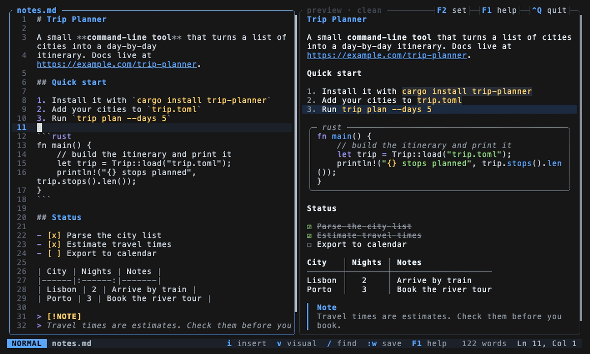

# mdedit

A terminal markdown editor where you edit inside the rendered document. The page looks rendered, like `glow`, and the block under your cursor opens as raw markdown so you can change it. No browser, no bloated IDE, no vault lock-in.


The same recording as a video: [demo/mdedit-demo.mp4](demo/mdedit-demo.mp4)

## Install

```bash
# Quick install (macOS / Linux)
curl -fsSL https://raw.githubusercontent.com/sho-luv/mdedit/main/install.sh | sh
```

The installer downloads the latest release binary and, for releases that publish a `SHA256SUMS` file, verifies the download against it before installing.

```bash
# From source (requires Rust 1.75+)
cargo install --git https://github.com/sho-luv/mdedit.git
```

Pre-built binaries are available on the [Releases](https://github.com/sho-luv/mdedit/releases) page.

## Usage

```bash
mdedit file.md             # Edit an existing file
mdedit new-file.md         # The file is created on first save
mdedit --view split        # Start in another view: live, split, editor, preview
mdedit --theme dracula     # Override the color theme
mdedit --mode nano         # Use nano-style keybindings instead of vim
mdedit --version
```

## Views

`Ctrl+P` cycles through four views.



| View | What you see |
|------|--------------|
| **Live** (default) | The rendered document. The block under the cursor (a paragraph, heading, list item, code block, or table) shows its raw markdown; move away and it renders again. |
| **Split** | Raw markdown on the left, rendered preview on the right, scroll-synced line by line. |
| **Editor only** | Raw markdown, full width. |
| **Preview only** | Rendered document, full width, read-only. |

In live view, tables and code blocks open whole, and list items open one at a time. Clicking rendered text moves the cursor there and opens that block.

## Features

- Vim-style modal editing (Normal / Insert / Visual / Command), or nano-style keys
- Rendered tables, task lists, callouts (`> [!NOTE]`, Obsidian `> [!tip]`), links, and syntax-highlighted code blocks
- Four preview styles (clean, GitHub, Obsidian, CommonMark) and four color themes
- Markdown syntax highlighting in the editor, soft word wrap at word boundaries, current-line highlight
- Status bar with mode, unsaved-changes marker, word count, and cursor position; scrollbars
- Search with match highlighting
- System clipboard integration, including over SSH
- Mouse support: click to place the cursor, wheel to scroll, drag to select or resize panes (split view)
- Atomic saves that keep the file's permissions and follow symlinks
- Starts instantly: the editor is on screen in about a millisecond, and the preview renders on a background thread so typing never waits on it
- A single binary under 4 MB; works over SSH and in 256-color terminals

## Keybindings

Press `F1` (or type `:help`) for the in-app reference.

### Vim mode (default)

#### Normal mode

| Key | Action |
|-----|--------|
| `h/j/k/l` | Move cursor |
| `w/b/e` | Word forward / back / end |
| `0/$` | Line start / end |
| `gg/G` | File start / end |
| `i/a/o/O` | Enter insert mode |
| `d{motion}` | Delete |
| `c{motion}` | Change (delete + insert) |
| `y{motion}` | Yank (copy) |
| `p/P` | Paste after / before |
| `dd/yy/cc` | Line operations |
| `x` | Delete character |
| `u` | Undo |
| `Ctrl+R` | Redo |
| `v/V` | Visual mode (char / line) |
| `/` | Search (`Enter` accepts, `n`/`N` next/previous, `Esc` clears highlights) |
| `:w` | Save |
| `:q` | Quit (refuses if there are unsaved changes) |
| `:wq` | Save and quit |
| `:q!` | Quit without saving |
| `:42` | Go to line 42 |
| `:help` | Keybindings help |

#### Insert mode

| Key | Action |
|-----|--------|
| `Esc` | Return to Normal mode |
| All other keys | Type normally |

### Nano mode

| Key | Action |
|-----|--------|
| `Ctrl+S` | Save |
| `Ctrl+Q` | Quit (asks if there are unsaved changes) |
| `Ctrl+F` | Search (`Enter` next match, `Esc` closes) |
| `Ctrl+C` | Copy selection to clipboard |
| `Ctrl+V` | Paste from clipboard |
| `Ctrl+Z` / `Ctrl+Y` | Undo / redo |
| `Tab` / `Shift+Tab` | Indent / outdent |

### Global (both modes)

| Key | Action |
|-----|--------|
| `F1` | Help overlay |
| `F2` | Settings panel |
| `Ctrl+P` | Cycle view: live / split / editor only / preview only |
| `Ctrl+Q` | Quit (asks if there are unsaved changes) |
| Mouse wheel | Scroll |
| Click | Place cursor (live, editor) or focus a pane (split) |
| Click title button | `^P view`, `F2 set`, `F1 help`, `^Q quit` |
| Drag the border between panes | Resize panes (split view) |

In split view, click or scroll the preview to focus it. Arrow keys (and `j`/`k`/`g`/`G` in vim Normal mode) then scroll the preview, and scroll-sync pauses until you click back into the editor.

## Configuration

`F2` (or `:set` in vim mode) opens the settings panel. Changes apply immediately; choose **Save as default** to keep them.



| Command | Action |
|---------|--------|
| `:set` | Open the settings panel |
| `:set theme dracula` | Switch theme |
| `:set profile obsidian` | Switch preview style |
| `:set wrap` | Toggle word wrap |
| `:set mode nano` | Switch keybindings (takes effect on restart) |
| `:set save` | Save current settings to the config file |

Config file: `~/.config/mdedit/config.toml` (or `$XDG_CONFIG_HOME/mdedit/config.toml`). A config already saved in the OS-native location (`~/Library/Application Support/mdedit/` on macOS) is still read and updated in place.

```toml
# Keybindings: "vim" (default) or "nano"
mode = "vim"

# Color theme: "ocean" (default), "dracula", "solarized-light", "gruvbox-dark"
theme = "ocean"

# Preview style: "clean" (default), "github", "obsidian", or "commonmark"
render_profile = "clean"

# Starting view: "live" (default), "split", "editor", or "preview"
view = "live"

# Highlight the cursor's line in the split-view preview (default: true)
sync_indicator = true

# Soft-wrap long lines in the editor at word boundaries (default: true)
word_wrap = true
```

### Preview styles

| Style | Look |
|-------|------|
| `clean` | Minimal: plain bold headings, outlined code blocks with a language label, borderless tables (a `Header: value` list when the pane is too narrow), and a centered reading column capped at 100 columns |
| `github` | Ruled headings, shaded code blocks, boxed tables, alerts (`> [!NOTE]`) |
| `obsidian` | Like `github`, plus wikilinks (`[[page]]`), tags (`#tag`), and Obsidian callouts |
| `commonmark` | Strict CommonMark with no extensions (no tables) |

### Themes

- `ocean`: default; dark, uses your terminal's background
- `dracula`: purple-tinted dark
- `gruvbox-dark`: warm dark
- `solarized-light`: light

## Clipboard

Yanks and deletes go to the system clipboard, and paste reads from it.

- **Local**: `pbcopy`/`pbpaste` (macOS), `wl-copy`/`wl-paste`, `xclip`, or `xsel` (Linux)
- **SSH**: OSC 52 escape sequences, supported by most modern terminals
- **tmux**: detected automatically; the sequence is wrapped for passthrough

## Recording the demos

The GIFs and video above are recorded from the real app with [VHS](https://github.com/charmbracelet/vhs):

```bash
cargo build --release
vhs demo/demo.tape
vhs demo/screenshots/layouts.tape
vhs demo/screenshots/settings.tape
```

## Requirements

- macOS or Linux
- A terminal with 256-color or truecolor support
- Rust 1.75+ to build from source
